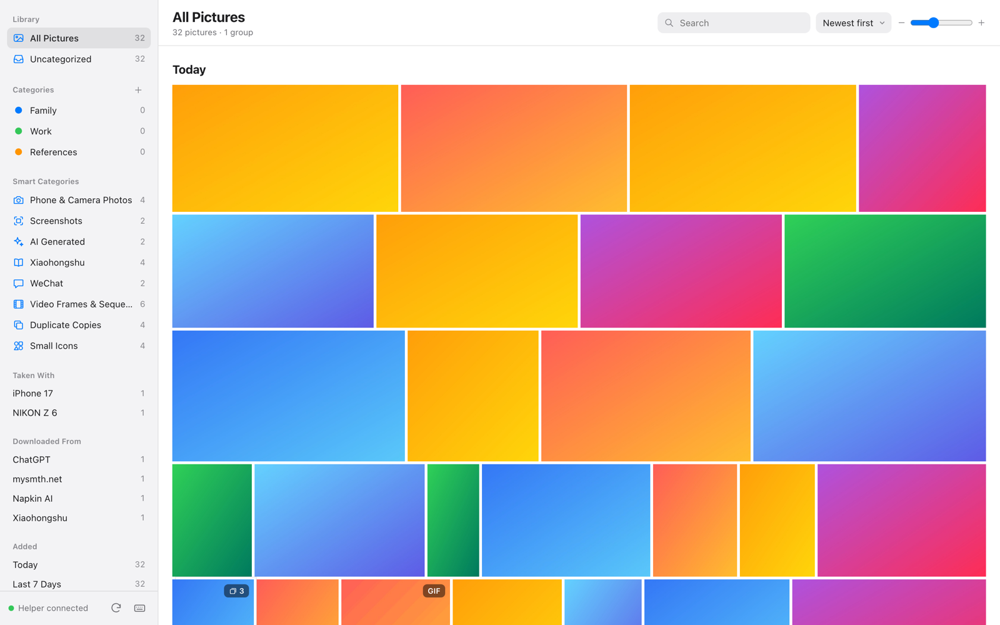
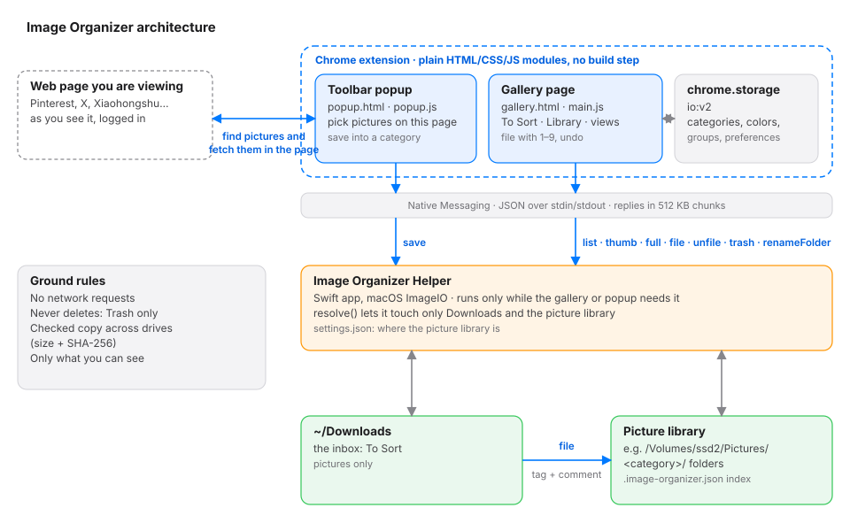
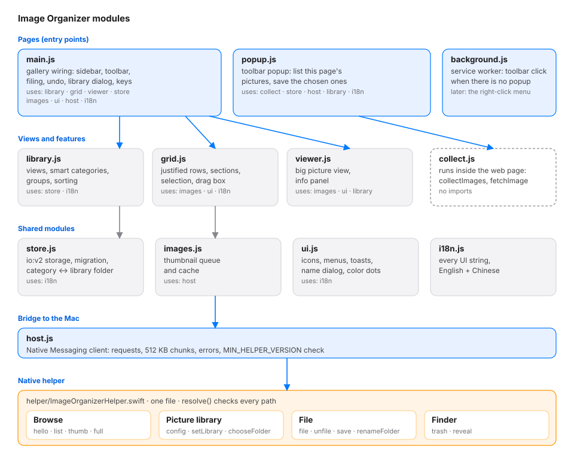

# Image Organizer

**English** | [中文](README.zh-CN.md)

A Chrome extension for the pictures piling up in your Mac's **Downloads** folder: see them all in one place, file them with a single key into your own picture library (for example on an external drive), and move the ones you don't need to the Trash. Downloads gets emptier as you go. Pictures on web pages can go straight into the library too: pick them in the toolbar popup, or right-click one.

It looks and feels like Apple Photos, and it runs entirely on your Mac.

Screenshots use generated sample pictures.

> **Status:** v2.4. macOS only. Works in Google Chrome, and in Edge, Brave, Arc and Vivaldi.
> The interface is in English or Chinese, following your browser's language.

---

## Why

The Downloads folder is where screenshots, saved posts, references and photos from chats all end up.
Finder shows them as a long list of file names. Photos wants to import them into a library.
Neither helps with the actual job: **go through them quickly, keep what matters, sort it, and clear out the rest.**

## What it does

- **Save pictures from web pages straight into a category.** Click the toolbar icon on any page: it lists the page's pictures at the largest size the page offers (small icons hidden), you pick some and save them into a category, named after the page in page order. Or right-click a picture → **Save to Picture Library ▸ category**. Each picture is fetched inside the page, the way the page itself loads it. Without the helper, pictures go to `Downloads/Image Organizer/<page title>/`.
- **Downloads becomes an inbox.** Filing a picture **moves it out of Downloads** into a picture library folder you choose (an external drive works well), one folder per category. The original is removed only after the copy has been checked byte for byte; a picture already in the library is not stored twice. Each filed picture gets a Finder tag (its category) and a Finder comment saying where it came from.
- **Shows every picture in Downloads**, sub-folders included, newest first, in date sections (Today, Yesterday, This Week, by month). Thumbnails keep each picture's shape.
- **Sorting at the speed of a keypress.** Open a picture, press `1`–`9` to move it into a category of your picture library, and the next one appears. `⌫` moves it to the Trash. `⌘Z` undoes anything.
- **Your own categories**, with names and colors you choose. Drag pictures onto a category in the sidebar, or press a number key.
- **Smart categories, worked out from the files themselves**: phone & camera photos, screenshots, AI-generated images, Xiaohongshu, WeChat, animated images, video frames & numbered sequences, **duplicate copies**, files over 5 MB.
  - **Downloaded from**: the website each picture came from (Xiaohongshu, ChatGPT, Weibo…), read from the record your browser keeps with every download.
  - **Taken with**: the phone or camera model (iPhone 17, NIKON Z 6…).
  - **Small icons are kept out of the way**: favicons, logos and website assets are hidden everywhere except under "Small Icons".
  - Plus filters by time added and by sub-folder. Empty ones are hidden, and every section folds away.
- **Groups.** Pictures saved from the same Xiaohongshu post (`_1_title.jpg`, `_2_title.jpg`, …) are grouped automatically. You can make your own groups too.
- **Select like in Photos**: click the circle, ⌘-click, Shift-click a range, or drag a box.
- **A proper viewer**: click the left or right side of the picture to move, swipe with two fingers, pinch to zoom, double-click for 100%, and a film strip at the bottom.
- **HEIC and TIFF** are shown too (converted in memory by macOS; the original is never changed).
- **Light and dark mode**, following your Mac.

| Sorting in the viewer | Selecting several pictures |
|---|---|
|  |  |

## Install

Step-by-step guide, no coding needed: **[docs/INSTALL.md](docs/INSTALL.md)**.

In short:

1. Download `image-organizer-vX.Y.Z.zip` from [Releases](https://github.com/songxiaofeng1981/image-organizer/releases/latest) and unzip it.
2. In Terminal, run `bash install.sh` from that folder.
3. In `chrome://extensions`, turn on Developer mode → **Load unpacked** → choose `~/Applications/Image Organizer/extension`.
4. Click the extension icon and allow access to Downloads when macOS asks. The first time you file a picture, choose where your picture library should be.

Upgrading from 1.x? Just run the new installer and click reload on the existing card. Your categories carry over. See [the guide](docs/INSTALL.md#coming-from-version-1x-图片整理mac-试用).

## Everyday use

| You want to | Do this |
|---|---|
| Look at a picture | Click it. Use `←` `→`, click the sides, or swipe with two fingers. |
| File it | Press `1`–`9` (the number next to each category in the sidebar). It moves into that category's folder of your picture library, and the next picture opens. `0` moves a library picture back to Downloads. |
| Get rid of it | Press `⌫`. It goes to the Trash after a few seconds; `⌘Z` or **Undo** brings it back. |
| Work on many at once | Click the circle on a picture, then ⌘-click, Shift-click, or drag a box. Use the bar at the top, a number key, or drag onto a category. |
| Go through new downloads | Open **To Sort → Downloads**, open the first picture, and keep pressing number keys. It tells you how many are left. |
| Save pictures from a web page | Click the toolbar icon, pick pictures, choose a category, **Save to Category** (or **Save to Downloads**). |
| Save one picture you are looking at | Right-click it → **Save to Picture Library ▸** a category, or **Save to Downloads only**. The toolbar icon shows ✓ (or ! with the reason). |
| Select a whole day or month | Click **Select** next to the date. **Select All** is next to the view title; click again to deselect. |
| Change where the library is | Click **⋯** next to "Picture Library" in the sidebar. |
| See all shortcuts | Press `?`. |

## Privacy and safety

- **Only the page you ask for.** The extension reads a web page only when you click its icon or its right-click menu there (Chrome's `activeTab`), and asks for no access to all websites. New in 2.4: permission to manage downloads (for **Save to Downloads**).
- **Nothing leaves your Mac.** The helper never goes online. The extension only fetches the pictures you pick on a web page, inside that page, and sends nothing anywhere. The "Downloaded from" information is read from your own files; only website names are used.
- **Only Downloads and your picture library, only pictures.** The helper refuses any path outside those two folders, hidden files, symbolic links and non-image files.
- **Never deletes.** "Move to Trash" uses the macOS Trash, so you can always put a file back from Finder. Moving to another drive removes the original only after an identical copy is in place.
- **Never changes your pictures' content.** Pixels and EXIF stay as they are. Filing adds a Finder tag and comment (file attributes, visible in Finder) and keeps a hidden `.image-organizer.json` index in the library folder. Category colors and groups are stored by Chrome for this extension.
- **Not running in the background.** Chrome starts the helper when the gallery opens and it quits when the tab closes.

## Troubleshooting

See [Something went wrong?](docs/INSTALL.md#something-went-wrong) in the install guide. To test the helper without Chrome, run `bash selftest.sh`.

## How it works

A Chrome extension cannot read your Downloads folder by itself, and macOS protects Downloads with its own permission. A tiny helper app does the file work and asks macOS for permission once. The toolbar popup (in development for 2.4) finds the pictures on the page you are viewing and fetches them inside that page, then the helper writes them straight into a category. Details and the message protocol are in [docs/DESIGN.md](docs/DESIGN.md).

The code is split into small modules, with no build step:

Both diagrams are SVG files drawn by `python3 dev/make_diagrams.py`; run it again when the structure changes.

## Contributing

Issues and pull requests are welcome, in English or Chinese. You can run the whole gallery in a normal browser tab against a sample folder, without installing anything into Chrome. See [CONTRIBUTING.md](CONTRIBUTING.md).

## License

[MIT](LICENSE)
