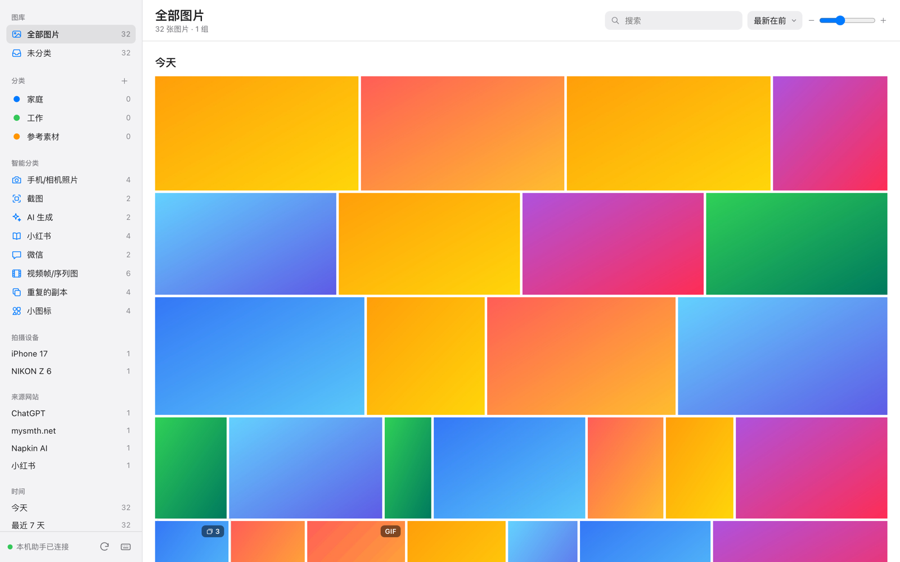
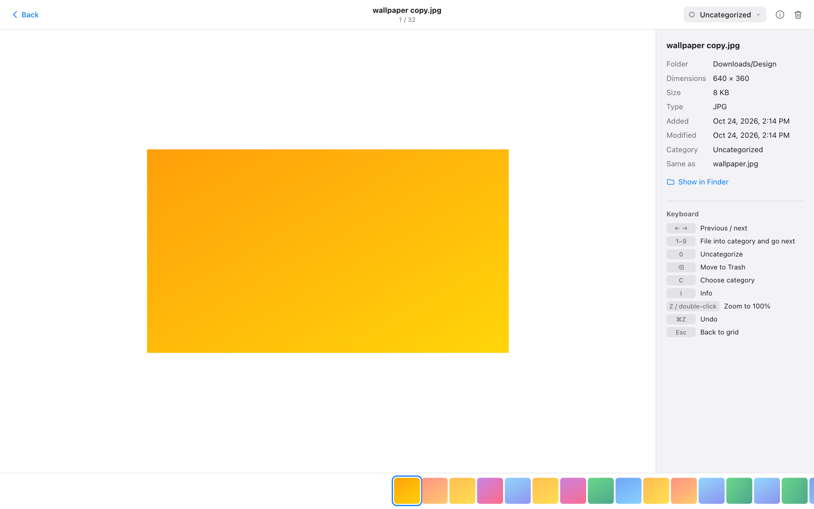
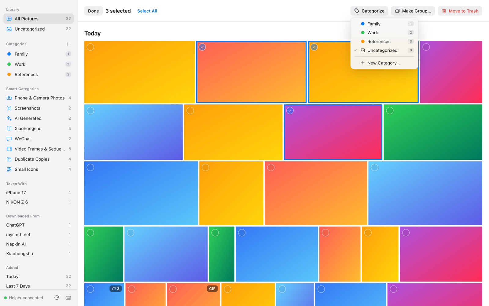

# 图片整理

[English](README.md) | **中文**

一个 Chrome 插件，专门对付 Mac **“下载”**文件夹里越堆越多的图片：在一个页面里看全部图片，按一个键就把它收进你自己的图片库（比如外置硬盘上），用不着的移到废纸篓。“下载”会越整理越空。网页上的图片也能直接存进图片库：在工具栏小窗口里挑，或者对着图片点右键。

界面和操作参照 Apple“照片”，所有处理都在你自己的 Mac 上完成。

截图使用的是生成的示例图片。

> **状态：** v2.4。只支持 macOS。可用于 Google Chrome，也可用于 Edge、Brave、Arc、Vivaldi。
> 界面有中文和英文，跟随浏览器的语言。

---

## 为什么做这个

截图、收藏的笔记、参考图、聊天里存下的照片，最后都堆在“下载”文件夹里。
访达只给你一长串文件名，“照片”App 又要把它们导入图库。
两者都不适合真正要做的事：**快速过一遍，留下有用的，分好类，把剩下的清掉。**

## 能做什么

- **网页上的图片直接存进分类。** 在任何网页上点工具栏图标，小窗口列出这一页的图片（取网页提供的最大尺寸，隐藏小图标），挑几张存进某个分类，文件按网页标题和页面顺序命名。也可以对着一张图点右键 →“保存到图片库 ▸ 分类”。每张图都在网页里取数据，和网页自己加载时一样。没装本机助手时，图片存到“下载/图片整理/<网页标题>/”。
- **“下载”变成收件箱。** 归类会**把图片从“下载”移走**，放进你选的图片库文件夹（放在外置硬盘上很合适），每个分类一个子文件夹。复制完会逐字节核对，确认无误才移走原件；图片库里已有的图不会再存第二份。每张收进来的图都会加上访达标签（分类名）和访达注释（记下它的来历）。
- **显示“下载”里的所有图片**，包括子文件夹。最新的在前，按今天、昨天、本周、各月份分段。缩略图保持每张图的原始比例。
- **按一个键就归类。** 打开一张图，按 `1`–`9` 移到图片库的对应分类，自动跳到下一张。按 `⌫` 移到废纸篓。所有操作都能用 `⌘Z` 撤销。
- **自定义分类**，名称和颜色都由你定。可以把图片拖到侧边栏的分类上，也可以按数字键。
- **智能分类，根据文件本身的信息判断**：手机/相机照片、截图、AI 生成、小红书、微信、动图、视频帧/序列图、**重复的副本**、大于 5 MB 的文件。
  - **来源网站**：每张图是从哪个网站下载的（小红书、ChatGPT、微博……），读取的是浏览器给每个下载文件留下的记录。
  - **拍摄设备**：手机或相机型号（iPhone 17、NIKON Z 6……）。
  - **小图标不再碍眼**：网站图标、logo、网页素材这类小图，除了“小图标”分类，其他地方都不显示。
  - 另外还能按加入时间和子文件夹筛选。没有图片的项不显示，每个分区都能折叠。
- **组。** 从同一篇小红书笔记保存的图（`_1_标题.jpg`、`_2_标题.jpg`……）会自动成组，你也可以自己建组。
- **像“照片”一样选择**：点圆圈，⌘ 单击，Shift 单击连选，或者拖框。
- **好用的大图查看**：点图片左右两侧切换，双指左右滑动，双指捏合缩放，双击看原始大小，底部有胶片栏。
- **HEIC、TIFF** 也能显示（由 macOS 在内存里转换，原图不会被修改）。
- **浅色、深色模式**，跟随系统。

| 在大图里整理 | 一次选择多张 |
|---|---|
|  |  |

## 安装

不需要编程基础的分步说明：**[docs/INSTALL.zh-CN.md](docs/INSTALL.zh-CN.md)**。

简单来说：

1. 从 [Releases](https://github.com/songxiaofeng1981/image-organizer/releases/latest) 下载 `image-organizer-vX.Y.Z.zip` 并解压。
2. 在终端里运行这个文件夹里的 `bash install.sh`。
3. 在 `chrome://extensions` 打开开发者模式 → **加载已解压的扩展程序** → 选择 `~/Applications/Image Organizer/extension`。
4. 点插件图标，macOS 询问时允许访问“下载”。第一次归类时，选好图片库放在哪里。

从 1.x 升级？运行新的安装程序，然后点旧插件卡片上的刷新图标就行，分类会自动保留。详见[安装说明](docs/INSTALL.zh-CN.md#从-1x-版本图片整理mac-试用升级)。

## 日常使用

| 想做什么 | 怎么做 |
|---|---|
| 看一张图 | 单击它。用 `←` `→`、点图片两侧，或双指左右滑动切换。 |
| 归类 | 按 `1`–`9`（侧边栏每个分类旁边的数字），图片会移到图片库里这个分类的文件夹，并自动打开下一张。按 `0` 把图片库里的图移回“下载”。 |
| 不要了 | 按 `⌫`。几秒后移到废纸篓；在此之前按 `⌘Z` 或点“撤销”就能恢复。 |
| 一次处理多张 | 点图片上的圆圈，再 ⌘ 单击、Shift 单击或拖框。然后用顶部的按钮、数字键，或拖到分类上。 |
| 整理新下载的图 | 打开 **“待整理 → 下载”**，打开第一张，一直按数字键。顶部会显示还剩多少张。 |
| 保存网页上的图片 | 点工具栏图标，挑图片，选分类，点“存到分类”（或“存到下载”）。 |
| 存下正在看的一张图 | 对着它点右键 →“保存到图片库 ▸”某个分类，或“只存到‘下载’”。工具栏图标会显示 ✓（失败显示 !，鼠标放上去能看到原因）。 |
| 选中一天或一个月 | 点日期旁边的“选择”。视图标题旁边有“全选”，再点一次取消。 |
| 更换图片库位置 | 点侧边栏“图片库”旁边的 **⋯**。 |
| 查看所有快捷键 | 按 `?`。 |

## 隐私与安全

- **只读你要它读的网页。** 只有在网页上点插件图标或右键菜单时，插件才读取这一页（Chrome 的 `activeTab`），不申请“读取所有网站”的权限。2.4 新增“管理下载内容”权限（用于“存到下载”）。
- **数据不出你的 Mac。** 本机助手从不联网。插件只在网页里取你选中的图片，不向任何地方发送数据。“来源网站”读取的是你自己文件上的记录，只用到网站域名。
- **只碰“下载”和你的图片库，只碰图片。** 本机助手拒绝这两个文件夹以外的路径、隐藏文件、符号链接和非图片文件。
- **从不直接删除。** “移到废纸篓”用的是 macOS 的废纸篓，随时可以在访达里放回原处。移到另一块硬盘时，要等完全相同的副本放好，才会移走原件。
- **从不修改图片内容。** 像素和 EXIF 保持原样。归类会加上访达标签和注释（文件属性，在访达里能看到），并在图片库里保存一个隐藏的 `.image-organizer.json` 索引。分类颜色和组由 Chrome 为这个插件保存。
- **不在后台运行。** 打开图库时 Chrome 才启动本机助手，关掉标签页它就退出。

## 遇到问题

请看安装说明里的[遇到问题？](docs/INSTALL.zh-CN.md#遇到问题)。不经过 Chrome 测试本机助手：运行 `bash selftest.sh`。

## 工作原理

Chrome 插件本身无法读取“下载”文件夹，macOS 也用单独的权限保护“下载”。所以由一个很小的助手程序负责文件操作，并向 macOS 申请一次权限。工具栏小窗口（2.4 开发中）找出你正在看的网页上的图片，在网页里取出图片数据，再由本机助手直接存进分类。细节和消息协议见 [docs/DESIGN.zh-CN.md](docs/DESIGN.zh-CN.md)。

代码分成几个小模块，不需要构建：

两张图都是 SVG，由 `python3 dev/make_diagrams.py` 画出；结构变了就重新运行。

## 参与贡献

欢迎提 issue 和 PR，中文英文都可以。不用往 Chrome 里装任何东西，就能在普通浏览器标签页里对着示例文件夹运行整个图库。见 [CONTRIBUTING.md](CONTRIBUTING.md)。

## 许可证

[MIT](LICENSE)
