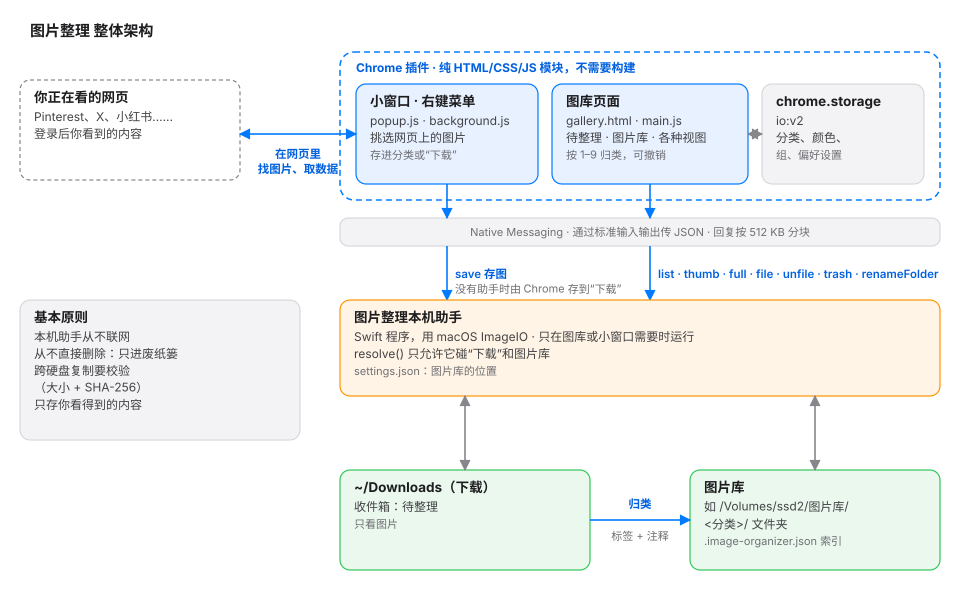
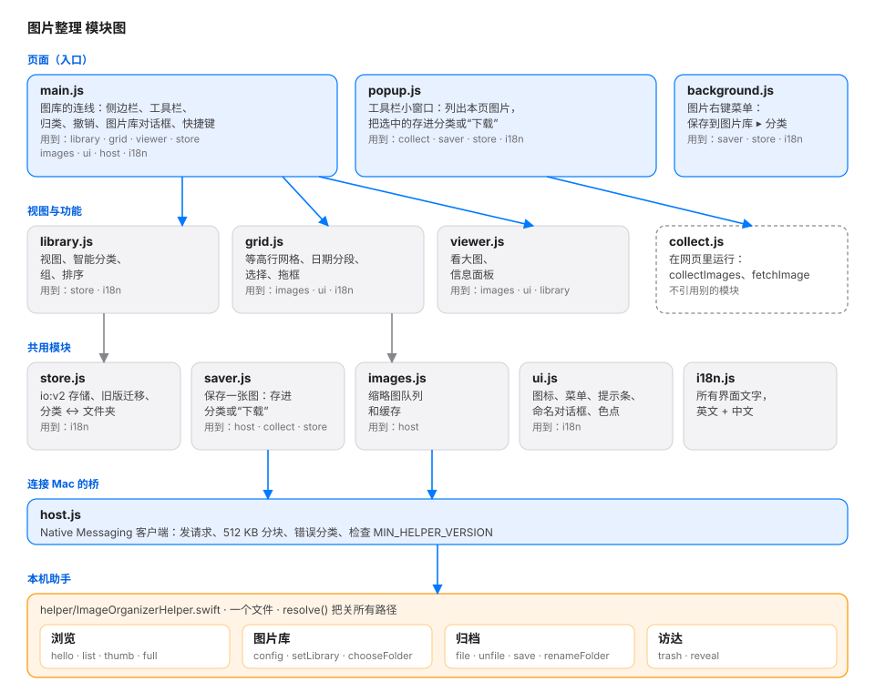

# 设计说明

[English](DESIGN.md) | **中文**

说明这个项目为什么这样做。较大的改动前请先读；如果改动和其中某个决定冲突，请说明是哪一条、为什么。

## 1. 要解决的事

“下载”文件夹里会堆满图片：截图、收藏的笔记、参考图、聊天里存下的照片。要做的事是**筛选整理**：每张快速看一眼，留下有用的并分类，把剩下的清掉。所以设计上把“过图的速度”放在第一位，浏览和搜索放在第二位。

从 2.3 开始，“下载”只当收件箱（“待整理”）。归类会**把图片从“下载”移走**，放进你选定的图片库文件夹（比如外置硬盘上），这样“下载”越整理越空，而不是越积越多（见 3.12）。

## 2. 结构





```
extension/  （Chrome 页面，纯 ES 模块，不需要构建）
  gallery.html, gallery.css, popup.html, popup.css
  js/main.js      图库：把各部分连起来，侧边栏、工具栏、操作、键盘
  js/popup.js     工具栏小窗口：当前网页上的图片，存进分类
  js/collect.js   在网页里运行：collectImages、fetchImage（不引用别的模块）
  js/library.js   筛选、排序、侧边栏筛选、组、日期分段
  js/grid.js      等高行排列、虚拟滚动、选择（全选、按日期分段选）
  js/viewer.js    大图查看：切换、缩放、胶片栏、信息面板
  js/images.js    缩略图队列和 blob URL 缓存
  js/store.js     分类、组、偏好设置，存在 chrome.storage.local
  js/host.js      Native Messaging 通信
  js/i18n.js      中英文界面文字
  js/ui.js        图标、菜单、提示条、命名对话框
helper/ImageOrganizerHelper.swift   （单个文件，只用 Foundation 和 ImageIO）
dev/make_diagrams.py                画出上面两张图
```

## 3. 关键决定

### 3.1 用本机助手，通过 Native Messaging 通信

Chrome 插件不能随意读取本地文件夹。File System Access API 每次打开都要用户重新选文件夹，不能解码 HEIC，也不能用废纸篓。而且 macOS 还用单独的隐私权限保护“下载”。

所以文件操作交给一个小的 Swift 程序。打开图库时 Chrome 通过 Native Messaging 启动它，页面关闭时它就退出。没有本地网页服务器，不开端口，也不在后台常驻。

助手是一个 App 包（`ImageOrganizerHelper.app`），有固定的 Bundle ID 和 `NSDownloadsFolderUsageDescription`。这样 macOS 只会清楚地询问一次“想要访问‘下载’文件夹”，之后会记住你的选择。

### 3.2 助手的权限刻意收得很窄

页面传来的每个路径都要经过 `resolve()` 检查：

- 必须是相对路径，在“下载”之内（或带 `lib:` 前缀、在图片库之内），不能有 `..`，也不能有隐藏的路径部分。
- 路径中的任何一级都不能是符号链接。
- 必须是普通文件，且扩展名在允许的图片格式之内。

图片库用 `setLibrary` 设置，拒绝系统文件夹、个人文件夹本身、`~/Library`，以及“下载”里面或包含“下载”的位置。分类文件夹名必须是单独一级的普通名称（不能有 `/`、`:`，不能以点开头）。

助手还会核对调用方的 origin（Chrome 作为第一个参数传入）是否是本插件的 ID。

### 3.3 只移到废纸篓，从不删除；撤销不需要碰废纸篓

助手用 `FileManager.trashItem`，所以在访达里总能“放回原处”。

为了支持应用内撤销，页面会立刻隐藏这张图，然后**等大约 6 秒才通知助手**。这段时间内撤销，只要取消隐藏就行。如果要从废纸篓里把文件拿回来，需要“完全磁盘访问权限”，这个应用不应该申请这种权限。关闭或切走标签页时，等待中的请求会立即发出。请求失败的话，图片会重新显示。失败时的结果是“文件没被移动”，这是安全的一侧。

### 3.4 速度

- **先知道形状，再加载像素。** 列文件时，助手并行地只读文件头里的像素尺寸（不解码），所以等高行排列第一次显示就是最终布局，不会跳动。
- **只有附近的行在页面里。** 网格会计算所有行的位置，但只有可见区域上下约一屏内的图块才放进 DOM。
- **缩略图由 ImageIO 生成**，文件自带的缩略图够大时直接用。请求“后到先做”：刚滚动到的图块先加载，已经滚出屏幕的请求会被丢弃。
- **助手最多同时处理 4 个请求**，大图不会卡住缩略图。
- **大图查看先显示缩略图**，再换成原图，并预加载前后几张。

### 3.5 数据存在哪里

分类（名称、颜色、顺序）、组和显示偏好，都存在 `chrome.storage.local` 的一个键 `io:v2` 下。不往“下载”里写任何东西。

一张图属于哪个分类，由**文件所在的位置**决定：在 `<图片库>/截图/` 里的图就属于名为“截图”的分类。所以即使移除插件或重装 Chrome，整理结果也还在；图片库里没有对应分类的文件夹，下次扫描时会自动成为分类。`io:v2` 里的 `assign` 现在只保存 2.3 之前归过类、但还在“下载”里的图，页面会提示“把已归类的 N 张移到图片库”。

图片库的位置保存在 `~/Library/Application Support/ImageOrganizer/settings.json`（由助手写入）。

1.x 的数据（`image-organizer:.image-categories.json`、`…groups.json`）会在第一次启动时迁移一次。插件的 ID 保持不变（`manifest.json` 里的 `key`），所以更新后数据还在。移除插件会清空这些数据，这也是安装程序原地更新 1.x 的原因。

已知限制：组按文件路径记录，在访达里重命名或移动文件后，它会离开原来的组。在访达里把文件移到图片库的另一个文件夹，分类也会跟着变，这是预期的。

### 3.6 “加入时间”

日期分段用的是文件**被放进所在文件夹的时间**（`addedToDirectoryDate`，即访达里的“添加日期”），对“下载”来说就是下载的时间。修改时间往往更早（图片最初生成的时间），用它会把新下载的图分到错误的段里。

### 3.7 自动成组

小红书会把一篇笔记的图保存为 `_1_标题.jpg`、`_2_标题.jpg`…… 或 `标题_1_xxx.jpg`。这些图按文件名自动成组（`library.js` 里的 `autoGroup()`）。一组显示为一个叠放的图块，点开进入组视图。“保存为组”会把自动组变成可以重命名的手动组。

### 3.8 外观

参照 macOS 的“照片”：白色内容区，浅灰侧边栏，系统蓝是唯一的强调色，红色只用于废纸篓，使用系统字体，跟随系统的浅色/深色外观。缩略图铺满图块，没有留白和边框。文件信息放在大图的信息面板里，而不是写在每张缩略图下面。

### 3.9 智能分类

“下载”里的图片大多没有像样的文件名，但文件本身带着很多信息。列文件时，助手会读取这些信息（不解码像素）：

| 信息 | 来源 | 用于 |
|---|---|---|
| 网站 | `com.apple.metadata:kMDItemWhereFroms`，浏览器给每个下载文件附加的记录。只把域名发给页面。 | “来源网站”、小红书、微信、AI 生成 |
| 相机厂商和型号 | EXIF/TIFF | “拍摄设备”、手机/相机照片 |
| 截屏标记 | `kMDItemIsScreenCapture`，或 EXIF 注释 “Screenshot”（macOS 和 iOS 都会写） | 截图 |
| 帧数 | ImageIO | 动图 |
| 完全相同的副本 | SHA-256，只对字节大小和其他文件相同的文件计算 | 重复的副本（除最早的那个之外的所有副本） |

页面在此基础上再加规则（`library.js` 的 `prepare()`）：HEIC/HEIF 和 `IMG_1234.JPG` 算手机照片；形状像手机屏幕的 PNG（如 1179×2556）算截图；同一文件夹里五个以上连续编号的文件（`frame-001.png`……）算视频帧/序列图；常见 AI 文件名（`ChatGPT Image…`、`DALL·E…`、`Gemini_Generated_Image…`）算 AI 生成。

**小图标**（ICO、SVG、256 像素以内的图，以及 512 像素以内、像 `logo-CRQNAZ12.png` 这样的网页打包素材）除了“小图标”和你手动归入的分类外，其他视图都不显示。在真实的“下载”文件夹里，它们常常占到五分之一，只会碍事。

### 3.10 安静的侧边栏

只有“待整理”“图片库”和“智能分类”的行带图标，分类带颜色圆点；拍摄设备、来源网站、时间、文件夹都只有文字。按文件生成的列表（设备、网站、文件夹）先显示数量最多的五项，并提供“显示全部”。没有图片的行不显示；点分区标题可以折叠（会记住）。

### 3.11 不需要构建

插件就是普通的 HTML、CSS 和 ES 模块。不用装 Node 就能阅读和修改，仓库里的文件夹就是 Chrome 加载的内容。

### 3.12 图片库

```
<图片库>/                    例如 /Volumes/ssd2/图片库
  家庭/  工作/  …            每个分类一个文件夹
  .image-organizer.json      每张图的来历（隐藏文件）
```

- **归类就是移动。** 按 `1`–`9`（或用菜单、拖放）会把图片移到 `<图片库>/<分类>/`。按 `0` 把图片库里的图移回“下载”，原来的子文件夹还在就放回原处。撤销会把图片移回去。
- **只有确认副本无误后才移走原件。** 同一块硬盘上只是改个位置。跨硬盘时，助手先用隐藏的 `.io-partial-…` 名字复制，比对大小和 SHA-256，把副本改成正式名字，最后才移走原件。任何一步失败，原件都还在。
- **不存第二份。** 如果图片库里已经有内容完全相同的文件（按索引里的 SHA-256 判断），就不再复制，下载的那份移到废纸篓。
- **不会重名覆盖。** 需要时 `photo.jpg` 会变成 `photo 2.jpg`，任何文件都不会被覆盖。
- **每张归档的图都带着来历**：访达标签（分类名和颜色，`_kMDItemUserTags`）、访达注释（`kMDItemFinderComment`：来源网站、原文件名、下载时间、收入时间），以及浏览器原有的下载记录（`kMDItemWhereFroms`，随文件一起复制）。索引里记录原文件名和路径、下载和收入时间、大小、SHA-256 和来源网站。像素和 EXIF 从不改动。
- **重命名或改颜色**会同时重命名对应的文件夹，并更新其中图片的标签。文件夹里还有图片的分类不能删除。
- **硬盘可能没接上。** 这时图片库分区显示“未连接”；“待整理”照常可用，归类要等硬盘接上。
- **小图标不收进图片库。** 它们不出现在“待整理”里，只在“小图标”里列出。
- 图片库放在外置硬盘（或桌面、文稿）里时，macOS 会询问一次访问权限；助手的 `Info.plist` 里有对应的说明文字。

## 4. 消息协议

每个请求是一个带 `id` 和 `op` 的 JSON 对象。助手用同一个 `id` 回复一条或多条消息。回复顺序可能和请求顺序不同。

| 请求 | 回复 |
|---|---|
| `{op: "hello"}` | `{type: "result", version}` |
| `{op: "list"}` | 每批 200 条的 `{type: "images", items: [...]}`，最后 `{type: "done"}` |
| `{op: "thumb", path, size}` | 若干 `{type: "chunk", data}`（base64，每块 ≤512 KB），最后 `{type: "done", mime}`。内容是 JPEG，或 SVG 文件本身。 |
| `{op: "full", path}` | 和 thumb 相同。Chrome 能显示的格式返回原始字节；HEIC/HEIF/TIFF 返回 JPEG（≤4096 像素）。 |
| `{op: "trash", paths: [...]}` | `{type: "result", ok, trashed: [...], failed: [{path, error}]}` |
| `{op: "reveal", path}` | `{type: "result", ok}`（打开访达并选中该文件） |
| `{op: "config", name}` | `{type: "result", library?, available, suggestions: [...]}`。`name` 是建议位置用的文件夹名（“图片库”）。 |
| `{op: "setLibrary", path, name}` | 保存后，回复同 `config`（最后一级文件夹不存在时会新建） |
| `{op: "chooseFolder", prompt}` | `{type: "result", ok, path?}`，来自 macOS 的“选择文件夹”窗口 |
| `{op: "file", items: [{path, comment?, removeTag?}], folder, tag: {name, color}}` | `{type: "result", ok, moved: [{from, to, duplicate?}], failed: [...]}` |
| `{op: "unfile", items: [{path, removeTag?}]}` | 格式同 `file`；`to` 相对于“下载” |
| `{op: "renameFolder", from, to, removeTag, tag}` | `{type: "result", ok}`；`to` 已存在时报错 `folder_exists` |
| 出错 | `{type: "error", error}`，带一个简短代码，如 `invalid_path`、`not_found`、`no_downloads`、`no_library`、`library_offline`、`bad_library`、`invalid_folder` |

`list` 返回的每一项：`{path, name, folder, ext, size, added, modified, width, height}`，以及仅在有值时才带的 `make`、`model`、`screenshot: true`、`frames`（>1）、`from`（域名）和 `duplicateOf`（原件路径）。`path` 和 `folder` 相对于“下载”；图片库里的图，`path` 是 `lib:` 加图片库内的路径，并带有 `library: true`、`filed`，以及（来自索引的）`originalName`，它们的 `added` 是当初的下载时间。`width`/`height` 已考虑 EXIF 方向，未知时为 0（如 SVG）。

Chrome 限制助手发来的单条消息不超过 1 MB，所以要分块。

## 5. 已知不足

- 只支持 macOS。Windows 版助手需要换一种生成缩略图和使用回收站的方式。
- 收件箱只读“下载”；图片库是唯一的另一个文件夹。
- 更换图片库位置不会搬动旧位置里已有的图片。
- 组按文件路径记录，在访达里重命名或移动文件会离开原来的组。
- 缩略图还没有磁盘缓存，每次打开页面都会重新生成（多数文件有内嵌缩略图，所以很快）。
- 没有上架 Chrome 应用商店，所以需要开发者模式。
